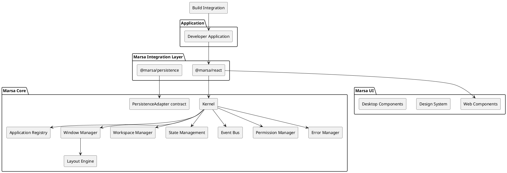

# SPEC-001-Marsa — Web Application Framework

**Project name:** Marsa (مرسى)  
**Working tagline:** A harbor for web applications. Bringing web applications together into one seamless workspace.  
**Document status:** Architecture specification — approved design decisions, with explicitly identified open decisions  
**Initial release:** 0.x MVP  
**Repository:** `marsa`

---

## Background

Marsa is a framework for building modern administrative dashboards and web applications.

Its purpose is to bring multiple web applications together into one seamless workspace, reducing the need for users to navigate between separate pages, browser tabs, and disconnected application experiences.

Marsa provides a desktop-like environment in which registered applications run inside independently managed windows. The experience takes inspiration from GNOME 40, Pop!_OS, and tiling window managers. It combines freely movable windows, optional tiling, workspaces, a dock, and application lifecycle management.

Marsa is intended to be extensible and independent of any particular rendering strategy. Its core must not depend on React, SSR, SPA, or a specific router.

React will be the first supported framework integration, while native Web Components will provide a framework-independent UI library.

The initial implementation will prioritize a functional MVP with clear extension points for more advanced capabilities.

### Product objectives

- Provide a consistent framework for building administrative dashboards.
- Provide one cohesive desktop application experience.
- Allow multiple applications to coexist within one dashboard.
- Manage application instances, windows, workspaces, and lifecycle centrally.
- Provide reusable, customizable UI components.
- Keep the architecture framework-independent wherever practical.
- Provide a predictable developer experience with TypeScript and Vite.
- Support future framework adapters and extensibility.

### Naming and branding

The project will use the name **Marsa (مرسى)**.

The name represents a harbor where different applications come together.

This is a working name. Package, domain, GitHub, npm, and trademark availability should be checked before public launch.

---

## Requirements

Requirements use the following MoSCoW prioritization:

- **Must:** Essential for the MVP.
- **Should:** Important, but can be postponed if necessary.
- **Could:** Valuable future capability.
- **Won't (for MVP):** Explicitly outside the initial release.

### 1. Core framework

| ID      | Requirement                                                      | Priority |
| ------- | ---------------------------------------------------------------- | -------- |
| CORE-01 | Provide a headless framework kernel.                             | Must     |
| CORE-02 | Provide a desktop application runtime.                           | Must     |
| CORE-03 | Keep core independent of UI frameworks and rendering strategies. | Must     |
| CORE-04 | Provide an application registry.                                 | Must     |
| CORE-05 | Provide application lifecycle management.                        | Must     |
| CORE-06 | Expose stable public APIs and typed contracts.                   | Must     |
| CORE-07 | Support future framework adapters.                               | Should   |
| CORE-08 | Provide extension points for future plugins.                     | Should   |

### 2. Desktop application runtime

| ID     | Requirement                                                            | Priority |
| ------ | ---------------------------------------------------------------------- | -------- |
| FLT-01 | Provide a desktop shell.                                               | Must     |
| FLT-02 | Register and launch applications as windows.                           | Must     |
| FLT-03 | Support single-instance and multiple-instance policies.                | Must     |
| FLT-04 | Support moving, resizing, minimizing, maximizing, and closing windows. | Must     |
| FLT-05 | Manage focus and z-order centrally.                                    | Must     |
| FLT-06 | Support workspaces.                                                    | Must     |
| FLT-07 | Support basic window snapping.                                         | Should   |
| FLT-08 | Support advanced automatic tiling.                                     | Could    |
| FLT-09 | Support tabbed window groups.                                          | Could    |
| FLT-10 | Support Shake to Focus presentation.                                   | Could    |

### 3. Runtime and application management

| ID     | Requirement                                                                   | Priority |
| ------ | ----------------------------------------------------------------------------- | -------- |
| APP-01 | Separate application definitions from application instances.                  | Must     |
| APP-02 | Lazy-load application JavaScript.                                             | Must     |
| APP-03 | Mount applications only when launched.                                        | Must     |
| APP-04 | Unmount applications when closed.                                             | Must     |
| APP-05 | Preserve application state during virtualization when using Marsa state APIs. | Must     |
| APP-06 | Support centralized error handling.                                           | Must     |
| APP-07 | Support lifecycle hooks and cancellable operations.                           | Should   |
| APP-08 | Support automatic application discovery through Vite.                         | Should   |

### 4. State and communication

| ID       | Requirement                                 | Priority |
| -------- | ------------------------------------------- | -------- |
| STATE-01 | Provide instance-scoped application state.  | Must     |
| STATE-02 | Provide IndexedDB persistence.              | Must     |
| STATE-03 | Support replaceable persistence adapters.   | Should   |
| STATE-04 | Provide a typed event bus.                  | Must     |
| STATE-05 | Support event access policies.              | Must     |
| STATE-06 | Support durable event delivery and retries. | Could    |
| STATE-07 | Support session restoration.                | Could    |

### 5. UI and design system

| ID    | Requirement                                         | Priority |
| ----- | --------------------------------------------------- | -------- |
| UI-01 | Provide framework-independent Web Components.       | Must     |
| UI-02 | Use Shadow DOM for desktop component chrome.        | Must     |
| UI-03 | Provide a unified design system.                    | Must     |
| UI-04 | Support light, dark, and system themes.             | Must     |
| UI-05 | Support configurable accent colors.                 | Must     |
| UI-06 | Provide a configurable icon provider.               | Must     |
| UI-07 | Support component replacement and extension points. | Should   |
| UI-08 | Support RTL layouts and localization.               | Must     |
| UI-09 | Target WCAG 2.2 AA accessibility.                   | Must     |

### 6. Security and permissions

| ID     | Requirement                                          | Priority |
| ------ | ---------------------------------------------------- | -------- |
| SEC-01 | Provide centralized capability-based permissions.    | Must     |
| SEC-02 | Default to denying ungranted capabilities.           | Must     |
| SEC-03 | Separate developer grants from runtime user consent. | Should   |
| SEC-04 | Support permission revocation.                       | Should   |
| SEC-05 | Provide an append-only permission audit log.         | Must     |

### 7. Developer experience

| ID    | Requirement                                                                   | Priority |
| ----- | ----------------------------------------------------------------------------- | -------- |
| DX-01 | Provide a Vite plugin.                                                        | Must     |
| DX-02 | Provide a centralized typed configuration API.                                | Must     |
| DX-03 | Provide typed, defaulted configuration without core config-schema validation. | Must     |
| DX-04 | Provide a floating desktop example project.                                   | Must     |
| DX-05 | Provide Vite HMR support.                                                     | Must     |
| DX-06 | Provide JSDoc documentation for public APIs.                                  | Must     |
| DX-07 | Provide Storybook component development.                                      | Must     |
| DX-08 | Provide an advanced developer inspector.                                      | Could    |

### 8. Engineering and release management

| ID     | Requirement                                          | Priority |
| ------ | ---------------------------------------------------- | -------- |
| ENG-01 | Use a single GitHub monorepo.                        | Must     |
| ENG-02 | Use pnpm workspaces, Nx, and Lerna.                  | Must     |
| ENG-03 | Use TypeScript strict mode.                          | Must     |
| ENG-04 | Use Vitest, React Testing Library, and Playwright.   | Must     |
| ENG-05 | Use GitHub Actions for CI/CD.                        | Must     |
| ENG-06 | Publish coordinated packages to npm.                 | Must     |
| ENG-07 | Support public alpha, beta, and RC releases.         | Must     |
| ENG-08 | Use npm Trusted Publishing with GitHub Actions OIDC. | Must     |
| ENG-09 | Maintain the latest two major release branches.      | Must     |
| ENG-10 | Follow a documented API deprecation policy.          | Must     |

---

## Method

### 1. High-level architecture

Marsa will use a layered architecture.

The core package owns framework-independent runtime behavior through domain services, domain schemas, and validation at runtime boundaries. Integration packages connect core services to UI frameworks.

The UI package provides native Web Components and does not depend on the core.

The Vite plugin provides build-time integration and configuration.



### 2. Monorepo structure

The repository will use the following structure:

```text
marsa/
├── packages/
│   ├── core/
│   │   └── src/
│   │       ├── kernel/
│   │       ├── application-registry/
│   │       ├── window-manager/
│   │       ├── workspace-manager/
│   │       ├── virtualization/
│   │       ├── layout-engine/
│   │       ├── state-management/
│   │       ├── event-bus/
│   │       ├── permissions/
│   │       ├── lifecycle/
│   │       ├── notifications/
│   │       └── errors/
│   │
│   ├── persistence/
│   │   └── src/
│   │       └── indexeddb-persistence-adapter.ts
│   │
│   ├── react/
│   │   └── src/
│   │       ├── providers/
│   │       ├── hooks/
│   │       ├── lifecycle/
│   │       └── renderers/
│   │
│   ├── ui/
│   │   └── src/
│   │       ├── foundation/
│   │       ├── primitives/
│   │       ├── desktop/
│   │       ├── window/
│   │       ├── dock/
│   │       ├── overview/
│   │       └── workspace-switcher/
│   │
│   ├── vite/
│   │   └── src/
│   │       ├── configuration/
│   │       ├── virtual-modules/
│   │       └── build-integration/
│   │
├── examples/
│   └── floating-dashboard/
│
├── playground/
├── docs/
├── tools/
├── nx.json
├── lerna.json
├── pnpm-workspace.yaml
└── package.json
```

Each package should expose only its intended public API through explicit `package.json` exports.

Internal implementation modules should remain private.

### 3. Package responsibilities and dependency rules

| Package              | Responsibility                                                | Dependencies                  |
| -------------------- | ------------------------------------------------------------- | ----------------------------- |
| `@marsa/core`        | Bootstrap, domain services, and framework-independent runtime | No UI or framework dependency |
| `@marsa/persistence` | Browser IndexedDB persistence adapter                         | Public contracts from core    |
| `@marsa/react`       | React providers, hooks, rendering and lifecycle integration   | Core, React                   |
| `@marsa/ui`          | Native Web Components and design system                       | No core dependency            |
| `@marsa/vite`        | Vite plugin and build configuration                           | Vite                          |

Dependency rules:

1. Core must never import React, Vite, or UI components. Zod is a supported runtime dependency of core for schema validation.
2. Core owns the persistence contract and must not import `@marsa/persistence` or browser APIs. Its state service exposes generic named collections; domain services own application/instance CRUD and choose their collection keys.
3. `@marsa/persistence` implements the core persistence contract and may depend on core only through its public exports.
4. UI must not import core.
5. React integration communicates with the core through public contracts.
6. UI communicates with the kernel through a framework-neutral `DesktopController` contract supplied by an adapter.
7. The Vite plugin performs build-time work only. Its generated client runtime module may call the public bootstrap API; runtime composition remains in core.
8. Core services own desktop domain behavior and authoritative runtime state. The kernel is a small composition and integration boundary.
9. Core schemas are organized by concern under `packages/core/src/schemas` and are the source of truth for public domain data types. The owning service validates values supplied by the host or applications.

Domain schemas live in modular files under `packages/core/src/schemas`; config modules contain config types, defaults, and merge behavior, not schemas. Public domain data types are inferred from schemas where practical. Core does not define or run a Zod schema for the overall Marsa configuration object. Services validate relevant domain/runtime inputs at their boundaries; values whose contents are intentionally opaque, such as application state payloads, remain opaque. Vite-specific build configuration is validated separately by the Vite package.

### 4. Desktop application runtime

Marsa provides a desktop shell with independently managed applications.

```ts
import { defineConfig } from 'vite';
import react from '@vitejs/plugin-react';
import { marsa } from '@marsa/vite';

export default defineConfig({
    plugins: [react(), marsa()],
});
```

The desktop shell is served from the host application's entry path, conventionally:

```text
/
```

Applications are launched as windows.

The host enters the runtime through `bootstrap(config)`. Configured plugins receive typed service access and use the application service to install definitions and the instance service to create or manage instances. The kernel class is not the application-facing entry point.

Illustrative target API (plugin and service names/signatures remain subject to implementation):

```ts
const marsa = await bootstrap({
    plugins: [usersPlugin],
});

await marsa.shutdown();
```

Application definitions must be registered before the desktop becomes interactive.

Application JavaScript must load lazily when an application is launched.

The application registry stores metadata and loaders without eagerly loading application components.

Instance policies:

```ts
type InstancePolicy = 'single' | 'multiple';
```

For single-instance applications, the application/instance services enforce the policy before creating another instance. The recommended default behavior is to focus the existing instance.

Application definition and runtime instance are separate entities.

Closing a window destroys its logical instance and unmounts its React tree. Launching it again creates a new instance unless durable application state is explicitly configured.

### 5. Bootstrap, service, and kernel architecture

`bootstrap(config)` is the runtime entry point. It resolves the configured defaults and plugins, composes the framework-independent services, and initializes integration features.

Domain services are the source of truth for their respective runtime behavior:

- Application service: definition installation, lookup, and registry operations.
- Instance service: creation, instance policy, lifecycle state, and destruction.
- Lifecycle service: hooks and transition coordination.
- Permission service: capability checks and revocation.
- Persistence service: adapter access and persistence operations.
- Error service: structured runtime failures and diagnostics.

The kernel is a small runtime composition/integration boundary. It coordinates bootstrap, plugin installation/cleanup, and service composition where needed. It must not duplicate domain behavior or become a second source of application state. UI integrations consume service/controller contracts and observe events; they do not own authoritative state.

Plugins receive a typed context containing the supported services and the shared event bus. They use services to install applications, create instances, and perform other runtime operations rather than calling kernel internals.

### React provider and runtime integration

The React package consumes a bootstrapped runtime or its public service/controller contracts; it does not construct the kernel or own domain state. The provider may coordinate framework-specific mounting, subscriptions, and cleanup, while application registration and instance lifecycle remain service-owned.

The Vite plugin performs build-time work. Generated client code may call the public bootstrap API and expose registration helpers, but it does not construct a public kernel instance or move business logic into Vite.

Exact provider and plugin context signatures should be finalized against the service contracts during implementation and maintained as versioned public contracts.

### 6. Application data model

The following TypeScript structures define the initial conceptual model.

```ts
interface ApplicationDefinition {
    id: string;
    title: string;
    description?: string;
    icon?: string;

    load: () => Promise<{
        default: React.ComponentType;
    }>;

    policies: {
        instances: 'single' | 'multiple';

        virtualization?: {
            enabled: boolean;
            preserveState: boolean;
            priority: 'low' | 'normal' | 'high';
        };
    };

    capabilities?: string[];
}
```

The core package must not depend on React types. Therefore, the actual core definition will use a framework-neutral loader contract, while `@marsa/react` will adapt the returned module to a React component.

An instance represents one launched application:

```ts
interface ApplicationInstance {
    id: string;
    appId: string;

    status: 'created' | 'loading' | 'mounted' | 'virtualized' | 'closing' | 'closed';

    createdAt: number;
    lastActiveAt: number;

    windowId?: string;
    workspaceId?: string;
}
```

IDs must be unique and generated by the runtime.

### 7. Window management

The window manager controls geometry, focus, stacking, and presentation state.

```ts
interface WindowGeometry {
    x: number;
    y: number;
    width: number;
    height: number;
}

type WindowState = 'normal' | 'minimized' | 'maximized' | 'snapped' | 'compact';

interface ManagedWindow {
    id: string;
    instanceId: string;
    workspaceId: string;

    geometry: WindowGeometry;
    state: WindowState;

    zIndex: number;
    focused: boolean;
}
```

Geometry uses CSS pixels relative to the active display viewport.

The window manager must:

- Respect minimum and maximum dimensions.
- Prevent windows from becoming completely inaccessible outside usable bounds.
- Account for reserved desktop regions such as docks.
- Maintain focus and z-order consistently.
- Preserve geometry during presentation changes.

The layout engine must be separate from the kernel. The window-management service coordinates operations, while the layout engine calculates geometry.

The MVP supports floating windows and basic snapping.

Advanced automatic tiling, tab groups, and multi-monitor support are planned for later releases.

### 8. Workspaces

A workspace represents an independent desktop environment containing windows.

```ts
interface Workspace {
    id: string;
    name: string;
    windowIds: string[];
    createdAt: number;
}
```

The workspace manager controls:

- Workspace creation and deletion.
- Active workspace selection.
- Window assignment.
- Workspace switching.
- Workspace-specific layout state.

The MVP supports basic workspace management. Advanced workspace restoration and complex tiling arrangements are post-MVP.

### 9. Application lifecycle

The lifecycle and instance services own lifecycle transitions. Framework integrations observe service events and mount/unmount UI in response; they do not commit authoritative lifecycle state.

Supported lifecycle events:

```ts
type LifecycleEvent =
    | 'onLaunch'
    | 'onMount'
    | 'onUnmount'
    | 'onVirtualize'
    | 'onRestore'
    | 'onMinimize'
    | 'onMaximize'
    | 'onFocus'
    | 'onBlur'
    | 'onClose'
    | 'onWorkspaceChange'
    | 'onPermissionRevoked';
```

Lifecycle operations follow a two-phase model.

**Before hooks:**

- Run before the operation.
- May perform asynchronous preparation.
- May return `false` to cancel the operation.
- May have configurable timeouts.

**After hooks:**

- Run after a successful operation.
- Are informational and non-cancellable.

For example, closing an application may invoke `onBeforeClose` to check unsaved changes.

Before hooks run sequentially and deterministically. If one hook cancels, the operation is aborted and previously prepared participants receive compensating cleanup in reverse preparation order.

Hook failures must be isolated and reported through the central error manager.

For normal user actions, a before-hook timeout cancels the operation. Forced shutdown or browser termination provides only best-effort cleanup.

### 10. Virtualization and state management

The MVP uses service-managed virtualization to control the number of mounted application windows.

The default policy is LRU (Least Recently Used).

Example configuration:

```ts
marsa({
    kernel: {
        virtualization: {
            enabled: true,
            maxMountedWindows: 5,
            idleTimeout: 60_000,
            strategy: 'lru',
        },
    },
});
```

An eligible inactive window may be virtualized:

1. Save Marsa-managed application state.
2. Unmount the React tree.
3. Keep the logical application instance in the instance service.
4. Preserve its window metadata.
5. Mount and restore the application when activated.

Arbitrary React-local state cannot be serialized automatically. Applications requiring restoration must use Marsa state APIs or an explicit persistence contract.

Applications may opt out of virtualization.

#### Application state API

Proposed React API:

```tsx
const [state, setState] = useAppState('filters', {
    status: 'active',
});
```

State is scoped to the application instance by default.

Closing an instance destroys its temporary state unless durable persistence has been explicitly enabled.

Durable state uses IndexedDB by default, with a replaceable persistence adapter.

The browser-specific IndexedDB adapter is published as `@marsa/persistence`. It implements the `PersistenceAdapterStrategy`, `PersistenceStore`, and `PersistedRecord` contracts exported by `@marsa/core`; it must not be imported by core. Hosts configure this adapter under `persistenceOptions.adapter`; `StateService` consumes it when `stateOptions.persistenceEnabled` is enabled. The core's in-memory adapter remains available for tests and non-browser hosts.

The adapter returns a handle scoped to one named store. Each handle supports keyed reads, writes, deletes, and enumeration of key-record pairs; its operations cannot access another store. Collections are caller-defined, such as `applications`, `application-instances`, or plugin-owned names.

The package opens IndexedDB lazily and creates each named object store on its first operation, upgrading the database as needed. The previous default object store remains available through the `application-state` store name for existing records. Writes are reported complete only after the transaction commits. The database name, legacy backing object-store name, minimum database version, and IndexedDB factory are configurable. Importing the package does not access browser globals; constructing the adapter without an IndexedDB implementation reports an explicit error.

Core's `StateService` exposes generic named collections and does not define application-, instance-, window-, or workspace-specific CRUD. `ApplicationManager` and `ApplicationInstanceManager` own domain behavior and use the `applications` and `application-instances` collections respectively. Active instance records are runtime-only. Collections support opaque versioned values, migrations, durability, debounced/batched writes, explicit flush/release, and structured failures. The global `stateOptions.persistenceEnabled` setting selects the configured adapter or in-memory storage; collection owners coordinate lifecycle flushing and cleanup. Application/session restoration is not implicit.

The persistence layer must support:

- Versioned state schemas.
- Migration functions.
- Debounced writes (300 ms default).
- Batched writes.
- Explicit flushing.
- Structured errors.
- In-memory fallback when persistence fails.

A failed persistence operation must never be reported as successful.

Session restoration is post-MVP and disabled by default.

### 11. Event bus

Applications communicate through the shared RxJS `Subject` event bus rather than direct imports between applications. Services publish domain events, and integrations/plugins may observe the event stream through its typed observable API. Event routing and permissions remain responsibilities of the relevant services.

Example:

```ts
eventBus.publish('user:updated', {
    userId: '123',
    name: 'Alice',
});

eventBus.subscribe('user:updated', event => {
    refreshOrdersForUser(event.userId);
});
```

Event scopes:

```ts
type EventScope = 'instance' | 'application' | 'dashboard';
```

Event metadata:

```ts
interface EventMetadata {
    eventId: string;
    timestamp: number;

    sourceAppId: string;
    sourceInstanceId: string;

    schemaVersion: number;
}
```

MVP behavior:

- Transient event delivery.
- Typed event contracts.
- Subscriber cleanup.
- Permission checks.
- Delivery to mounted and restored subscribers.
- Optional buffering for virtualized subscribers.

Post-MVP durable events:

- Persistent event storage.
- At-least-once delivery.
- Acknowledgements.
- Deduplication by event ID.
- Retry with exponential backoff.
- Dead-letter queue.
- Ordering within an event stream.

Ordering should be guaranteed per stream, not globally.

An optional stream key allows related events to preserve order:

```ts
eventBus.publish('user:updated', payload, {
    streamKey: `user:${payload.userId}`,
});
```

### 12. Permission and security architecture

Marsa uses centralized capability-based permissions.

Example capabilities:

```ts
type Capability =
    | 'events.publish'
    | 'events.subscribe'
    | 'storage.read'
    | 'storage.write'
    | 'windows.create'
    | 'workers.spawn'
    | 'notifications.send'
    | 'system.clipboard';
```

The owning service validates capabilities whenever an application attempts a protected operation.

Rules:

1. Default deny.
2. Applications cannot grant themselves capabilities.
3. Developer configuration defines the maximum permitted capability set.
4. Sensitive operations may additionally require runtime user consent.
5. Revocation must immediately block subsequent operations.
6. Active subscriptions and workers must respond to revocation.

Permission audit records are append-only:

```ts
interface PermissionAuditRecord {
    id: string;
    appId: string;
    instanceId?: string;

    capability: string;

    action: 'requested' | 'granted' | 'consented' | 'revoked' | 'denied';

    timestamp: number;
    reason?: string;
}
```

Sensitive information must not be included in audit records.

### 13. Error management

The runtime error service provides centralized error handling.

Error categories:

- `application`
- `integration`
- `kernel`
- `fatal`

Error structure:

```ts
interface DashboardError {
    code: string;

    category: 'application' | 'integration' | 'kernel' | 'fatal';

    severity: 'info' | 'warning' | 'error' | 'critical';

    message: string;
    source: string;

    timestamp: number;
    correlationId: string;

    recoverable: boolean;
    cause?: unknown;
}
```

Error handling rules:

| Category    | Handling                                      |
| ----------- | --------------------------------------------- |
| Application | Isolate the affected application              |
| Integration | Report adapter or UI failure                  |
| Kernel      | Attempt recovery while preserving valid state |
| Fatal       | Enter safe mode                               |

Safe mode should:

- Reject application installation/uninstallation, new instance creation, and new application launches.
- Reject instance progression to loading/mounted and nonessential lifecycle events.
- Keep state reads/writes, diagnostics, permission revocation, focus, virtualization/state flushing, and close/unmount operations available for recovery.
- Disable automatic layout behavior; no window/layout manager is implemented yet.
- Permit explicit subsystem restart or reload where a subsystem provides that operation; core currently has no restart loop or restart automation.
- Keep fatal error details available through runtime logging and avoid endless automatic restart loops.

Fatal safe mode is latched for the lifetime of the runtime. Leaving it requires an explicit runtime recovery/restart path; safe mode is never cleared automatically.

The default in-memory error history is a ring buffer of 500 records.

IndexedDB persistence and advanced diagnostics are configurable extensions.

### 14. Notification service

Notifications are managed through a central service.

```ts
interface NotificationService {
    show(notification: {
        title: string;
        message: string;

        severity: 'info' | 'success' | 'warning' | 'error';

        duration?: number;
        actions?: NotificationAction[];
    }): string;

    dismiss(notificationId: string): void;
    dismissAll(): void;
}
```

Notification ownership is associated with application and instance IDs.

Applications may dismiss their own notifications, but cannot dismiss notifications owned by other applications or the kernel.

The notification system should support:

- In-app toast notifications.
- Banners.
- Notification center.
- Read/unread status.
- Optional persistent history.
- Rate limiting.
- Duplicate grouping.
- Priority handling.
- Accessible screen-reader announcements.

Browser notifications and advanced history management are post-MVP.

### 15. UI architecture

`@marsa/ui` uses native Web Components with Shadow DOM.

It has three layers.

**Foundation**

- Design tokens.
- Typography.
- Theme management.
- Icon provider.
- Accessibility utilities.
- Accent color derivation.

**Primitives**

- Buttons.
- Inputs.
- Dialogs.
- Popovers.
- Menus.
- Tabs.
- Tooltips.
- Notifications.
- Toolbars.

**Desktop components**

- Desktop shell.
- Window container.
- Title bar.
- Window controls.
- Dock.
- Taskbar.
- Workspace switcher.
- Overview.
- Application launcher.
- Tiling controls.

Custom elements use the `marsa-` prefix:

```html
<marsa-button></marsa-button>
<marsa-window></marsa-window>
<marsa-dock></marsa-dock>
```

#### React mounting

The window component owns its visual frame and a dedicated content container.

The React integration owns framework mounting and unmounting.

React children must not be assumed to project automatically through a Web Component slot.

The adapter explicitly mounts React into the content container supplied by the Web Component.

#### Extension architecture

Four extension mechanisms are supported:

1. Full component replacement.
2. Region replacement.
3. Content injection.
4. Behavior extension through actions and events.

Extension points must use stable public identifiers rather than implementation-specific DOM selectors.

Dock regions include:

- Launcher.
- Pinned applications.
- Running applications.
- System actions.

### 16. Design system and theming

The design system takes inspiration from GNOME Libadwaita.

It uses:

- Rounded surfaces.
- Restrained shadows.
- Consistent spacing.
- Clear hierarchy.
- Adaptive layouts.
- Accessible focus states.
- Consistent interaction behavior.

Supported themes:

```ts
type ThemeMode = 'light' | 'dark' | 'system';
```

Users may configure one accent color.

Marsa derives the related hover, active, focus, selected, and subtle background colors automatically.

Structural design tokens such as spacing, typography, borders, sizing, and component behavior remain framework-controlled to preserve consistency.

#### Icon provider

Marsa uses a shared icon provider abstraction.

Lucide is the default implementation.

The selected provider must affect both application icons and built-in `@marsa/ui` icons.

Changing the provider must therefore update icons used in:

- Desktop shell.
- Dock.
- Window controls.
- Menus.
- Dialogs.
- Notifications.
- Built-in primitives.

The provider supports semantic icon lookup, sizing, styling, accessible/decorative rendering, and RTL-aware variants.

Missing icons must have a predictable fallback.

### 17. Internationalization and accessibility

English is the default locale.

Arabic and RTL support must be included from the beginning.

Requirements:

- Configurable locale and text direction.
- No hardcoded user-facing strings in framework components.
- Replaceable localization adapter.
- Direction-aware layout and icon behavior.
- Keyboard navigation.
- Accessible names and roles.
- Screen-reader support.
- Focus management.
- Reduced-motion support.
- Accessible dialogs, menus, notifications, and window controls.

The default UI targets WCAG 2.2 AA.

### 18. Configuration architecture

The primary configuration entry point is `@marsa/vite`.

Example:

```ts
marsa({
    kernel: {
        virtualization: {},
        workers: {},
        permissions: {},
        persistence: {},
    },

    windowManager: {
        snapping: {},
        workspaces: {},
        shakeToFocus: {},
    },

    notifications: {},

    ui: {
        theme: 'system',
        components: {},
    },

    diagnostics: {},
});
```

Core runtime configuration should be:

- Fully typed.
- Merged with explicit framework defaults.
- Immutable after bootstrap unless changed through an explicit runtime API.
- Inspectable through a resolved configuration API.

Configuration precedence:

1. Explicit runtime overrides.
2. Application-level configuration.
3. Environment-specific configuration.
4. Framework defaults.

Security settings must not be weakened by lower-trust runtime overrides.

Core uses Zod as a runtime dependency for domain schemas and runtime-boundary validation. The Vite package defines its own schema for plugin-specific build-time configuration; it does not use a separate validation adapter package.

Core intentionally does not define or run a Zod schema for the top-level configuration object. Config typing, defaults, and merge behavior belong to the config layer; domain/runtime schemas belong under `packages/core/src/schemas`. The Vite package continues to validate its own build-time plugin options.

The current core config state is process-global. Bootstrap calls share the active config and merge user options into it; repeated calls can retain earlier overrides, and concurrent bootstrap/plugin configuration is not isolated. Preserve this behavior unless a separate API change is approved. Do not document independent runtime configuration isolation.

### 19. Rendering architecture

Rendering strategy is not a core concern.

- `@marsa/core` is independent of SSR, SPA, hydration, and UI frameworks.
- `@marsa/react` handles React rendering and lifecycle integration.
- The host application and its JavaScript framework determine the rendering strategy.
- `@marsa/ui` remains framework-independent.

The React integration must handle browser-only initialization carefully when used in SSR environments.

### 20. Vite HMR

Marsa supports basic Vite HMR in development.

Requirements:

- Application component changes should update the affected application where possible.
- UI component changes should update presentation where possible.
- Registry and configuration changes may require controlled reinitialization.
- Production builds must not include unnecessary HMR runtime overhead.

Advanced state preservation during HMR is deferred.

No MVP guarantee is made for preserving window state, worker state, or arbitrary React-local state across module replacement.

### 21. Worker architecture — post-MVP

Background workers are a planned extension of the kernel.

The proposed design uses Web Workers by default.

Responsibilities:

- Lazy worker initialization.
- Per-instance worker isolation by default.
- Worker lifecycle management.
- Message validation.
- Timeouts and cancellation.
- Resource limits.
- Restart policies.
- Optional checkpoints.

Proposed React API:

```tsx
const worker = useAppWorker();

worker.send({
    type: 'PROCESS_DATA',
    payload: data,
});
```

A centralized worker scheduler will eventually manage priorities:

```ts
type WorkerPriority = 'low' | 'normal' | 'high';
```

Recommended initial resource defaults for the future implementation:

| Setting                  |    Default |
| ------------------------ | ---------: |
| Workers per app instance |          1 |
| Workers per dashboard    |          4 |
| Request timeout          | 30 seconds |
| Restart attempts         |          3 |
| Normal task slice        |  5 seconds |
| High-priority task slice | 10 seconds |
| Low-priority task slice  |  2 seconds |

These are cooperative scheduling targets, not hard browser CPU guarantees.

The scheduler may support cooperative pause/yield, checkpointing, exponential backoff, and persistence adapters.

The browser does not guarantee indefinite background execution. The implementation must document suspension and termination limitations.

### 22. Advanced window features — post-MVP

#### Automatic tiling

The layout engine will eventually support:

- Halves.
- Thirds.
- Quarters.
- Automatic placement.
- Workspace-specific arrangements.
- Tab groups.
- Keyboard shortcuts.

The algorithm should prioritize stability:

1. Preserve existing window positions where possible.
2. Place new windows in the least disruptive available region.
3. Redistribute space after windows close.
4. Recalculate only affected windows after resizing.
5. Respect minimum and maximum dimensions.
6. Group windows into tabs when they cannot fit without becoming unusable.

Manual arrangements should become user layout preferences.

#### Shake to Focus

A future presentation mode inspired by desktop window management.

Shaking the focused window's title bar causes it to expand while other visible windows move into compact edge positions.

The layout engine calculates the new arrangement.

The operation is transactional and reversible.

A snapshot stores previous geometry, workspace, z-order, and presentation state.

Exit mechanisms:

- Shake again.
- Escape.
- Restore action.

Keyboard access is mandatory. A proposed default shortcut is `Super + Shift + F`.

Reduced-motion preferences must be respected.

### 23. Repository engineering standards

The monorepo uses:

- pnpm workspaces.
- Nx for build orchestration and affected-project execution.
- Lerna fixed/locked version mode for coordinated package releases.
- TypeScript strict mode.
- ESLint.
- Prettier.
- Conventional Commits.

A package follows this convention:

```text
packages/core/
├── src/
│   ├── index.ts
│   └── ...
├── tests/
├── package.json
├── tsconfig.json
└── README.md
```

Story directories are included where applicable.

Public APIs must be documented through JSDoc.

### 24. Testing strategy

| Tool                  | Responsibility                                   |
| --------------------- | ------------------------------------------------ |
| Vitest                | Unit and integration tests                       |
| React Testing Library | React integration tests                          |
| Playwright            | End-to-end tests                                 |
| Storybook             | UI component development and interaction testing |
| Nx                    | Affected-project test execution                  |

Coverage targets:

- Kernel: 90%.
- Window manager and layout engine: 90%.

Coverage alone is insufficient. Tests must verify meaningful behavior and edge cases.

Critical E2E journeys must cover the desktop application experience.

Examples:

- Register an application.
- Launch and mount it.
- Focus and move its window.
- Minimize and restore it.
- Close and reopen it.
- Verify state and lifecycle behavior.

Accessibility testing must include keyboard interaction, focus management, and screen-reader semantics.

### 25. Browser support

The MVP targets the latest two stable versions of:

- Chrome.
- Edge.
- Firefox.
- Safari.

The desktop experience targets desktop browsers initially.

Mobile floating desktop behavior is deferred, although the architecture should remain responsive.

### 26. Release management

All packages use coordinated versions through Lerna fixed/locked mode.

SemVer policy:

- Major: breaking API changes.
- Minor: backwards-compatible functionality.
- Patch: bug fixes and compatible improvements.

Before 1.0, public APIs may evolve, but migration guidance must be provided for meaningful changes.

Release branches:

```text
main
v1.x
v2.x
v3.x
```

`main` contains ongoing development.

Long-lived major-version branches maintain released versions.

Only the latest two major versions are supported.

Security and critical fixes are backported to applicable supported branches.

### 27. CI/CD and npm publishing

GitHub Actions is the CI/CD platform.

Pull-request validation includes:

- Formatting.
- Linting.
- Type-checking.
- Tests.
- Builds.

Nx runs affected-project tasks.

Release workflows include:

- Release validation.
- Coordinated versioning.
- Changelog generation.
- Package builds.
- Publishing.
- Provenance generation where supported.

npm dist-tags:

| Release | Example         | Tag      |
| ------- | --------------- | -------- |
| Stable  | `3.2.0`         | `latest` |
| Alpha   | `3.3.0-alpha.1` | `next`   |
| Beta    | `3.3.0-beta.1`  | `next`   |
| RC      | `3.3.0-rc.1`    | `next`   |

Prereleases are publicly available on npm.

Publishing uses npm Trusted Publishing with GitHub Actions OIDC, avoiding long-lived npm publishing tokens.

Publishing must require successful CI validation and an authorized release workflow.

### 28. API deprecation policy

Marsa follows this lifecycle:

1. Mark the API as deprecated.
2. Document its replacement.
3. Keep it available throughout its current major version.
4. Remove it only in a new major version.
5. Provide migration guidance and codemods where practical.

### 29. MVP versus long-term architecture

The following table defines the implementation boundary.

| Capability                | MVP    | Post-MVP / Future        |
| ------------------------- | ------ | ------------------------ |
| Headless kernel           | Yes    | —                        |
| React integration         | Yes    | Vue/Svelte research      |
| Web Components UI         | Yes    | —                        |
| Floating windows          | Yes    | Advanced window features |
| Workspaces                | Basic  | Advanced restoration     |
| Window snapping           | Basic  | Automatic tiling         |
| Tab groups                | No     | Post-MVP                 |
| Shake to Focus            | No     | Post-MVP                 |
| App lifecycle             | Basic  | Advanced orchestration   |
| Virtualization            | Yes    | Advanced scheduling      |
| App state                 | Yes    | —                        |
| IndexedDB persistence     | Yes    | Additional adapters      |
| Transient event bus       | Yes    | Durable delivery         |
| Capability permissions    | Yes    | Runtime consent manager  |
| Permission audit log      | Yes    | Advanced management UI   |
| Error manager             | Yes    | Advanced diagnostics     |
| Notifications             | In-app | Browser integration      |
| Worker scheduler          | No     | Post-MVP                 |
| Session restoration       | No     | Post-MVP                 |
| Advanced HMR preservation | No     | Future research          |
| Multi-monitor             | No     | Future research          |
| Plugin ecosystem          | No     | Future research          |

The architecture must avoid implementing speculative infrastructure prematurely.

Future capabilities should be introduced through stable contracts and extension points rather than unnecessary MVP complexity.

---

## Implementation

Implementation should follow dependency order, with a working example application available as early as possible.

### Phase 1 — Monorepo foundation

1. Create the `marsa` GitHub repository.
2. Initialize pnpm workspaces.
3. Configure Nx.
4. Configure Lerna fixed versioning.
5. Create all package skeletons.
6. Configure shared TypeScript, ESLint, and Prettier.
7. Establish CI checks.
8. Establish package export conventions.

**Deliverable:** Buildable monorepo with all package skeletons.

### Phase 2 — Core bootstrap and services

1. Implement the `bootstrap(config)` runtime entry point.
2. Compose domain services from the resolved configuration.
3. Implement application registry and instance behavior in services.
4. Implement service-owned lifecycle orchestration, errors, and permission checks.
5. Route service events through the shared RxJS `Subject` event bus.
6. Expose typed services and event observation through the plugin/integration context.
7. Keep the kernel limited to composition and integration.
8. Use a core-owned `StateService` for application/instance CRUD and instance-scoped state; keep session restoration and plugin-context exposure as separate runtime work.

**Deliverable:** Framework-independent bootstrapped runtime with plugin-accessible services and focused tests.

### Phase 3 — React integration

1. Implement React provider.
2. Implement runtime initialization.
3. Implement application mounting.
4. Implement lifecycle hooks.
5. Implement `registerApp`.
6. Validate the rendering integration boundaries.

**Deliverable:** React integration for desktop applications.

### Phase 4 — Vite integration

1. Implement the Vite plugin.
2. Implement the Vite plugin configuration schema.
3. Implement virtual modules.
4. Validate plugin configuration with a Vite-package Zod schema.
5. Implement development and production profiles.
6. Implement basic HMR support.
7. Add configuration diagnostics.

**Deliverable:** Vite-powered Marsa application setup.

### Phase 5 — UI foundation

1. Implement design tokens.
2. Implement theme system.
3. Implement icon provider.
4. Implement Web Component foundation.
5. Implement Shadow DOM conventions.
6. Implement core UI primitives.
7. Implement accessibility behavior.
8. Implement RTL support.

**Deliverable:** Reusable Marsa UI library.

### Phase 6 — Floating desktop MVP

1. Implement desktop shell.
2. Implement desktop controller contract.
3. Implement window manager.
4. Implement window geometry engine.
5. Implement window component.
6. Implement window focus and z-order.
7. Implement dock and launcher.
8. Implement basic workspace manager.
9. Implement basic snapping.
10. Integrate React mounting and unmounting.

**Deliverable:** Functional desktop application experience.

### Phase 7 — State and virtualization

1. Implement instance-scoped state.
2. Implement persistence adapter interface.
3. Implement the `@marsa/persistence` IndexedDB adapter against the public core persistence contract.
4. Implement versioned state storage.
5. Implement virtualization scheduler.
6. Implement LRU policy.
7. Implement state restoration.
8. Test failed persistence and recovery.

**Deliverable:** Resource-aware desktop application runtime.

### Phase 8 — Notifications and security

1. Implement permission capability registry.
2. Implement developer grants.
3. Implement permission audit records.
4. Implement permission enforcement.
5. Implement notification service.
6. Implement notification UI.
7. Integrate errors with notifications.
8. Test permission revocation and isolation.

**Deliverable:** Secure application runtime with notification support.

### Phase 9 — Quality and release preparation

1. Complete unit and integration tests.
2. Complete desktop E2E tests.
3. Run accessibility testing.
4. Validate browser compatibility.
5. Document public APIs.
6. Complete the floating desktop example application.
7. Configure release workflows.
8. Configure npm Trusted Publishing.
9. Publish initial public prerelease.

**Deliverable:** Publicly installable Marsa MVP prerelease.

---

## Milestones

| Milestone                       | Outcome                         | Completion criteria                                 |
| ------------------------------- | ------------------------------- | --------------------------------------------------- |
| M1 — Foundation                 | Monorepo established            | Packages build and CI passes                        |
| M2 — Kernel                     | Core runtime operational        | Registry, lifecycle, events and permissions tested  |
| M3 — UI foundation              | Design system operational       | Web Components and themes work                      |
| M4 — Desktop runtime            | Desktop shell operational       | Apps launch and windows behave correctly            |
| M5 — State management           | Virtualization operational      | State restores after unmount/remount                |
| M6 — Security and notifications | Runtime protections operational | Permission and notification tests pass              |
| M7 — Release candidate          | MVP feature complete            | E2E, accessibility and browser checks pass          |
| M8 — Public release             | npm prerelease published        | Packages install and the example runs independently |

The project team should estimate calendar durations after breaking these milestones into implementation tasks.

---

## Gathering Results

The MVP will be evaluated against functional, technical, and developer-experience criteria.

### 1. Functional validation

**Desktop application runtime**

- Applications launch and close correctly.
- Single-instance policies are enforced.
- Windows can move, resize, focus, minimize, and maximize.
- Workspaces switch correctly.
- Applications mount and unmount correctly.

### 2. Runtime validation

- Bootstrap, services, and kernel remain independent of React.
- Core state remains authoritative.
- Virtualization does not destroy Marsa-managed application state.
- Persistence failures are handled safely.
- Application errors do not crash unrelated applications.
- Permission checks are enforced by owning services at operation boundaries.
- Core does not validate top-level configuration with a Zod schema.

### 3. Performance validation

Collect metrics for:

- Initial desktop startup time.
- Application launch latency.
- Lazy-loading performance.
- Window interaction responsiveness.
- Memory consumption as windows are opened.
- Virtualization and restoration latency.
- Event dispatch overhead.
- State persistence latency.

Performance budgets should be established using the first working implementation and representative dashboard workloads rather than arbitrary assumptions.

### 4. Accessibility validation

Verify:

- Keyboard-only operation.
- Focus visibility and management.
- Accessible names and roles.
- Screen-reader announcements.
- Reduced-motion behavior.
- Dialog and menu interaction.
- Contrast compliance.
- RTL behavior.

Target: WCAG 2.2 AA for the default UI.

### 5. Developer experience validation

Use the two example projects to evaluate:

- Installation and setup complexity.
- Configuration clarity.
- TypeScript API usability.
- Error-message usefulness.
- Application registration.
- HMR behavior.
- Public documentation quality.

### 6. Release validation

Before each release:

- All required CI checks pass.
- Package versions are compatible.
- Changelogs are generated.
- npm publishing permissions are verified.
- Provenance is generated where supported.
- Both example applications install and run against the published packages.

---

## Current Core Implementation Status

This section records the repository implementation separately from the target architecture above.

- `bootstrap(config)` currently uses the process-global config state, runs class-plugin configuration hooks, creates the entry module, and calls `MarsaApp.initialize()`.
- `MarsaApp.initialize()` and `shutdown()` are placeholders, and `initKernel()` is unfinished. The public `@marsa/core` entry point exports `bootstrap` and `StateService`; a plugin service context is not yet exposed.
- The current plugin and service wiring uses module metadata and a global IoC container. Application and helper services exist, but business behavior is incomplete and is not yet consistently available through plugins.
- The RxJS `EventBus` publishes through a `Subject` and supports observable event streams and ordered handlers, but domain services do not yet use one consistent publication path.
- `StateService` exposes generic named collections; application and instance managers use those collections for their records without adding domain-specific methods to the service. Collection persistence, migration, durability, scheduling, flush, and release are generic; lifecycle coordination remains with collection owners. Plugins can use the service through the shared service module, while a typed plugin context and session restoration remain unimplemented.
- Domain schemas exist for several concerns, but schema definitions are not yet fully consolidated under `packages/core/src/schemas`; some remain with config contracts. The top-level config object has no config-options Zod schema, and none should be added.
- The React, Vite, and example packages still use or generate the earlier direct-kernel API and require a separate migration after the core service API is established.

These are implementation gaps, not changes to the target architecture. The core refactor and its acceptance criteria are tracked in `PLAN.md`.

## Open Decisions and Implementation Assumptions

The architecture is sufficiently defined to begin implementation, but some low-level details require technical validation before they become public API commitments.

| Area                            | Open decision / assumption                                                          |
| ------------------------------- | ----------------------------------------------------------------------------------- |
| Single-instance launch          | Focus existing instance is the recommended default.                                 |
| Application discovery           | Explicit registration is the baseline; Vite glob discovery is optional.             |
| Default window dimensions       | Establish through UI prototyping.                                                   |
| Workspace limits                | Determine through usability and performance testing.                                |
| Runtime user consent            | Post-MVP permission manager.                                                        |
| Persistent event delivery       | Post-MVP.                                                                           |
| Worker scheduler                | Post-MVP.                                                                           |
| Session restoration             | Post-MVP.                                                                           |
| HMR state preservation          | Deferred pending practical experience.                                              |
| SSR behavior                    | Validate through the React integration and selected host framework.                 |
| Performance budgets             | Establish through baseline measurements.                                            |
| Package and dependency versions | Verify current supported versions and official documentation during implementation. |

These decisions must be recorded as implementation issues rather than silently assumed to be finalized.

---

## Need Professional Help in Developing Your Architecture?

Please contact me at [sammuti.com](https://sammuti.com) :)
